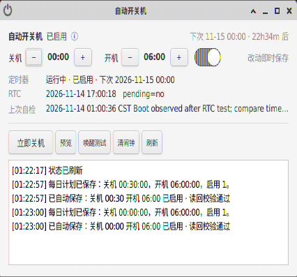
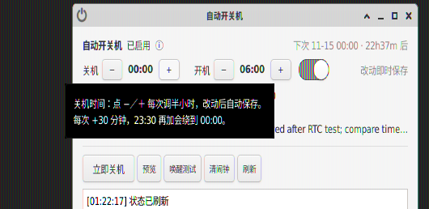

# autopower：自动关机与 RTC 自动开机

## 当前版本

本阶段提供两种用法：命令行 `autopower`（唯一实现与后台服务），以及一个**桌面双击即可打开的原生图形界面**（Python 3 + GTK3，不依赖任何额外安装的软件包）。两者读写同一份配置与同一套 systemd 定时器。

只安装一个命令：`autopower`。`on/off/now/set` 都是该命令的参数，不是独立程序。旧路径 `/usr/local/sbin/auto-power-cycle` 只是兼容链接，实际指向 `/usr/local/bin/autopower`。

当前保留的计划为：每天 **00:00 关机，06:00 自动开机**，时区为 Asia/Shanghai（北京时间）。

## 桌面界面（GUI）



界面精简到一屏，全部操作都不需要输入密码之外的打字：

- **关机 / 开机时间各一组 `− 时间 ＋`**，每次固定调半小时；没有文本输入框，避免格式报错。`00:00` 再按 `−` 会绕到 `23:30`，`23:30` 再按 `＋` 回到 `00:00`。
- **没有保存按钮**：每次按 `−／＋`（以及切换「启用」开关）都会在 0.6 秒内自动保存，并把配置读回来逐项校验，结果显示在下方日志区。
- **按钮分级**：`立即关机` 保持正常大小，`预览`、`唤醒测试`、`清闹钟`、`刷新` 收为小号，不干扰主功能。
- **鼠标悬停显示说明**：每个控件都有中文 tooltip，不弹窗、不遮挡界面。



安装与启动（幂等，可重复执行）：

```bash
cd ~/ubuntu/power-schedule
sudo bash ui/setup-autopower-ui.sh     # 安装启动器、桌面图标与免密规则
# 之后双击桌面「Autopower」图标，或在终端执行 autopower-gui
```

脚本会写入 `/etc/sudoers.d/autopower-ui`，只允许 `zhaojian` 免密执行 `/usr/local/bin/autopower`；删除该文件即可撤销免密。界面里的「立即关机」「唤醒测试」都会真正关机，执行前会先弹出应用内的确认条（Esc 取消）。

## 最常用操作

```bash
# 查看完整中文帮助
autopower help

# 设置每日 00:00 关机、06:00 开机，并启用
sudo autopower on -s 00:00 -w 06:00

# 查看配置、systemd 定时器、RTC 和上次测试结果
autopower status

# 预览现在手动关机将在何时自动开机；不写 RTC，也不关机
autopower now --dry-run

# 保存工作后，立即正常关机，并在接下来一个 06:00 自动开机
sudo autopower now
```

`now` 会真正关机，VNC/SSH 会断开，执行前必须保存工作。

## 参数说明

| 用法 | 作用 |
|---|---|
| `sudo autopower on` | 启用每日计划，保留已配置时间 |
| `sudo autopower on -s <时间> -w <时间>` | 设置时间并启用每日计划 |
| `sudo autopower off` | 停用每日计划，不是立即关机，也不清除已有 RTC 闹钟 |
| `sudo autopower set -s <时间> -w <时间>` | 修改时间，不改变启用/停用状态 |
| `sudo autopower now` | 立即正常关机，并写入下一次自动开机闹钟 |
| `autopower now --dry-run` | 只预览 `now` 的行为和唤醒时间 |
| `autopower status` | 查看当前状态 |
| `autopower next-wake` | 以键值格式显示下一次手动关机的唤醒时间 |
| `sudo autopower cancel-wake` | 清除尚未触发的 RTC 闹钟 |
| `autopower help` | 显示中文帮助；也支持 `--help`、`-h` |

`-s` 等同于 `--shutdown`，`-w` 等同于 `--wake`。

## 时间设置与校验

采用 24 小时制，只接受：

- `HH:MM`，例如 `00:00`、`06:00`、`23:30`；
- `HH:MM:SS`，例如 `23:30:15`。

小时必须为 `00～23`，分钟和秒必须为 `00～59`，不足两位必须补零。以下输入都会被拒绝：

```text
6:00
24:00
12:60
06:00:99
```

校验失败会输出中文错误，配置文件的校验和保持不变，不会应用部分修改。

手动执行 `sudo autopower now` 时：

- 如果当天开机时间距离现在超过 60 秒，选择当天；
- 如果当天开机时间已经过去或不足 60 秒，选择次日；
- `autopower now --dry-run` 可提前查看完整日期和时间。

## 工作原理

1. `auto-power-cycle.timer` 按配置的 `-s` 时间触发。
2. `/usr/local/bin/autopower run` 计算接下来一个 `-w` 时间。
3. `rtcwake --mode off --utc --time <epoch>` 写入 RTC 闹钟并正常关机。
4. 主板在待机供电保持的情况下响应 RTC 闹钟并启动。

手动 `autopower now` 与每日定时任务使用同一个关机函数，因此手动关机也能按配置时间自动开机。直接在桌面菜单或终端执行系统自带的 `poweroff`，不会经过本工具，也不会自动写入 RTC 闹钟。

配置和定时器更新使用锁防止并发写入；配置与 timer drop-in 使用临时文件原子替换。`Persistent=false` 防止电脑开机后补执行已经错过的关机任务。

## 配置与安装文件

| 路径 | 用途 |
|---|---|
| `/etc/auto-power-cycle.conf` | 关机时间、开机时间、每日计划启用状态 |
| `/etc/systemd/system/auto-power-cycle.timer.d/schedule.conf` | 根据配置生成的 `OnCalendar` |
| `/usr/local/bin/autopower` | 唯一 CLI/后台实现 |
| `/etc/sudoers.d/autopower-ui` | GUI 免密执行 `autopower` 的规则（删除即撤销） |
| `~/.local/bin/autopower-gui` | 桌面界面的启动器 |
| `~/.local/share/applications/autopower-gui.desktop` | 应用菜单项 |
| `~/Desktop/autopower-gui.desktop` | 桌面双击图标 |
| `/etc/systemd/system/auto-power-cycle.service` | 每日定时关机服务 |
| `/etc/systemd/system/auto-power-cycle.timer` | 每日定时器 |
| `/etc/systemd/system/auto-power-cycle-test-verify.service` | 真关机测试后的启动验证与状态恢复 |
| `/var/lib/auto-power-cycle/last-test-result` | 最近一次 RTC 测试结果 |
| `/var/log/auto-power-cycle-install.log` | 安装和升级记录 |

源文件位于 `~/ubuntu/power-schedule/`：

- `autopower`
- `auto-power-cycle.service`
- `auto-power-cycle.timer`
- `auto-power-cycle-test-verify.service`
- `setup-auto-power-cycle.sh`
- `ui/autopower_gui.py`（GTK3 桌面界面）
- `ui/setup-autopower-ui.sh`（界面启动器与桌面项安装脚本）
- `docs/images/`（README 截图）
- `README.md`
- `operation-log.md`

重新安装会保留已有配置和测试记录：

```bash
sudo ~/ubuntu/power-schedule/setup-auto-power-cycle.sh install
```

## 日志与检查

```bash
autopower status
journalctl -t auto-power-cycle --no-pager
systemctl list-timers auto-power-cycle.timer --all
sudo cat /var/log/auto-power-cycle-install.log
cat /var/lib/auto-power-cycle/last-test-result
```

## 真关机测试

以下命令会真正关机，不能当作 dry-run：

```bash
sudo autopower test 300
```

测试会暂停每日 timer，设置 300 秒后的 RTC 闹钟并关机；首次启动后自动写入测试结果并恢复配置中的每日计划状态。测试延迟允许 `120～3600` 秒。

图形界面里的「唤醒测试」按钮等同于 `autopower test <界面上填的秒数>`，同样会真关机，点击后先弹出确认条。

CLI 升级阶段只执行了 dry-run、配置和时间校验测试，**没有再次执行真实关机**。旧版已在 2026-11-09 00:12～00:17 完成一次成功的 5 分钟 RTC 真关机唤醒测试。

桌面界面在真机上完成过两次 RTC 真关机唤醒测试，实测记录（`/var/lib/auto-power-cycle/last-test-result`）：请求 00:55:16、预期 01:00:16、实际启动 01:00:36，差值 20 秒；醒来后自动恢复每日计划 `00:00 关机 / 06:00 开机`。

## 硬件依据与注意事项

- 主板为 ASUS B85-PLUS R2.0，官方手册支持 `Power On By RTC`。
- 本机 RTC 驱动为 `rtc_cmos`，硬件时钟使用 UTC；工具自动换算北京时间。
- 关机期间不能关闭插排或切断电源待机供电。
- 脚本和文档不保存 sudo 密码。
